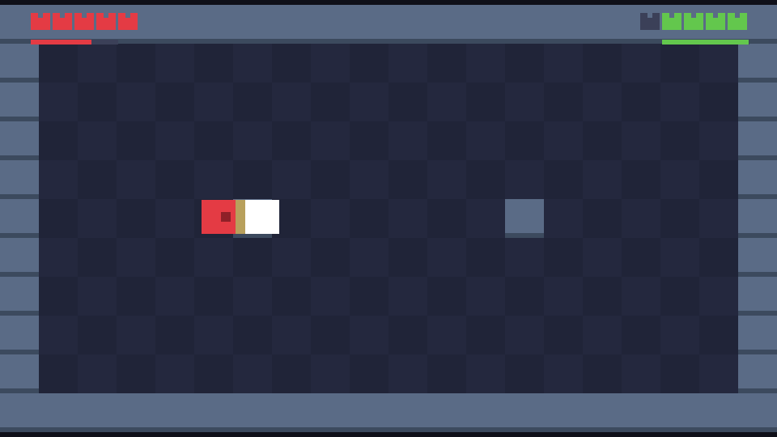

# Predator Versus Prey

Two squares settle their differences with daggers drawn. Stab, dodge-roll
through the swing, and knock your rival around a 320x180 pixel arena —
the training ground for a full 16-bit Zelda-style PvP game.



## Features

- Fixed-timestep 60 Hz simulation, integer-scaled rendering
- Stab with wind-up / active / recovery frames and a directional hitbox
- Dodge roll with i-frames, knockback, hitstop, screen shake
- Input buffering: a press stays queued for 100 ms, so an early stab or
  roll still comes out the moment it can
- Stamina: stabs and rolls cost energy that refills after a short pause,
  GW2-style
- Tiled arenas: author a map in Tiled, export `.tmj`, duel on it
- Headless selftest that CI runs on every push

## Build

| OS | packages |
| --- | --- |
| FreeBSD | `pkg install sdl3 cmake` |
| Debian / Ubuntu | `apt install libsdl3-dev cmake` |
| Arch | `pacman -S sdl3 cmake` |

```
cmake -B build
cmake --build build
```

## Play

`./build/pvp` — ESC quits, R restarts the round.

| action | P1 | P2 | gamepad |
| --- | --- | --- | --- |
| move | WASD | arrow keys | left stick / d-pad |
| stab | Space or E | Enter or Right Shift | A |
| dodge roll | Q or Left Shift | Right Ctrl or / | B or LB |

Stabs and rolls cost stamina — the slim bar under your hearts. It refills
after a short pause, so spamming three rolls in a row ends with you standing
still in front of a sword.

## Arenas in Tiled

1. New map: orthogonal, any size, **16x16 tiles** recommended
   (a 20x11 map = 320x176 fills the view almost exactly).
2. Paint walls on the **first tile layer** — every painted tile is solid,
   every empty cell is walkable floor. Any tileset works; `maps/pvp-tiles.tsx`
   ships a placeholder one.
3. Add an **object layer** with two objects named `p1` and `p2` (points or
   rectangles); their center is where that player spawns.
4. `File -> Export As... -> Tiled JSON map files (*.tmj)` into `maps/`.
5. `./build/pvp maps/duel.tmj`

Anything outside the map counts as solid, so border your arena. The map is
centered inside the 320x180 view; smaller maps get letterboxed.

## Selftest & CI

`./build/pvp --selftest` fast-forwards a scripted fight through the real
update pipeline (no display needed) and asserts that stab presses land:
two hits on P2, rematch reset, plus a full parse of a Tiled map from memory.
It exits non-zero on failure, which makes it a ready-made CI test —
`.github/workflows/ci.yml` builds SDL3 pinned to 3.4.20 on Ubuntu and the
`pkg` SDL3 on a FreeBSD VM, then runs it on every push.

`./build/pvp [map.tmj] --screenshot` runs the same script and writes
`screenshot.bmp` — handy for README shots and bug reports.

## Roadmap

- sprite sheets + animation state machine (SDL3_image is already queued up)
- real tile art to replace the placeholder rects
- audio, more weapons, stamina tuning toward the GW2 feel

## License

GPL-3.0 — see [LICENSE](LICENSE).
